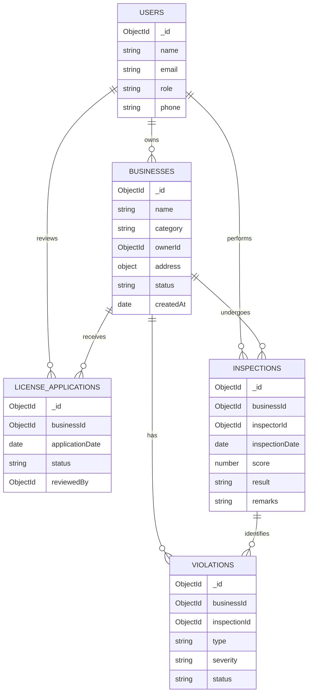

# SFA Business Licensing & Safety Audit Portal – Database Schema

## 1. Introduction

The SFA Business Licensing & Safety Audit Portal is a database-driven system designed to manage food businesses, license applications, inspections, and food safety violations under the Sindh Food Authority.

The project uses MongoDB Atlas as its database. It contains five main collections:

1. Users
2. Businesses
3. License Applications
4. Inspections
5. Violations

These collections store related information and use ObjectId references to connect documents where required.

---

## 2. Database Name

**Database:** `sfa_portal`

## 3. Collection Details

### 3.1 Users Collection

The `users` collection stores information about system users, including administrators, inspectors, and business owners.

| Field | Data Type | Description |
|---|---|---|
| _id | ObjectId | Unique user identifier |
| name | String | Full name of the user |
| email | String | User's email address |
| role | String | User role: admin, inspector, or business_owner |
| phone | String | Contact number |

**Example Document:**

```javascript
{
  _id: ObjectId("6ae8eae71f3d557a9da51ed2"),
  name: "SFA Administrator",
  email: "admin@sfa.example",
  role: "admin",
  phone: "03000000001"
}
```

### 3.2 Businesses Collection

The `businesses` collection stores information about food businesses registered with the Sindh Food Authority.

| Field | Data Type | Description |
|---|---|---|
| _id | ObjectId | Unique business identifier |
| name | String | Name of the food business |
| category | String | Business category |
| ownerId | ObjectId | References the business owner in Users |
| address | Object | Embedded address information |
| address.area | String | Business area |
| address.city | String | Business city |
| address.province | String | Province |
| status | String | Business registration status |
| createdAt | Date | Date the business record was created |

**Example Document:**

```javascript
{
  _id: ObjectId("6ae8eae71f3d557a9da51ed8"),
  name: "Hyderabad Food Corner",
  category: "Restaurant",
  ownerId: ObjectId("6ae8eae71f3d557a9da51ed5"),
  address: {
    area: "Latifabad",
    city: "Hyderabad",
    province: "Sindh"
  },
  status: "active",
  createdAt: ISODate("2026-09-01T00:00:00.000Z")
}
```

### 3.3 License Applications Collection

The `licenseApplications` collection stores applications submitted by food businesses for obtaining licenses.

| Field | Data Type | Description |
|---|---|---|
| _id | ObjectId | Unique application identifier |
| businessId | ObjectId | References the business in Businesses |
| applicationDate | Date | Date of application |
| status | String | Application status: pending, approved, or rejected |
| reviewedBy | ObjectId / Null | References the administrator who reviewed the application |

**Example Document:**

```javascript
{
  _id: ObjectId("6ae8eae71f3d557a9da51edb"),
  businessId: ObjectId("6ae8eae71f3d557a9da51ed8"),
  applicationDate: ISODate("2026-09-02T00:00:00.000Z"),
  status: "approved",
  reviewedBy: ObjectId("6ae8eae71f3d557a9da51ed2")
}
```

### 3.4 Inspections Collection

The `inspections` collection stores food safety inspection records created by SFA inspectors.

| Field | Data Type | Description |
|---|---|---|
| _id | ObjectId | Unique inspection identifier |
| businessId | ObjectId | References the inspected business |
| inspectorId | ObjectId | References the inspector in Users |
| inspectionDate | Date | Date of inspection |
| score | Number | Inspection score between 0 and 100 |
| result | String | Inspection result: Passed or Failed |
| remarks | String | Additional inspection comments |

**Example Document:**

```javascript
{
  _id: ObjectId("6ae8eae71f3d557a9da51ede"),
  businessId: ObjectId("6ae8eae71f3d557a9da51ed8"),
  inspectorId: ObjectId("6ae8eae71f3d557a9da51ed3"),
  inspectionDate: ISODate("2026-09-15T00:00:00.000Z"),
  score: 88,
  result: "Passed",
  remarks: "Good hygiene standards."
}
```

### 3.5 Violations Collection

The `violations` collection stores food safety violations identified during inspections.

| Field | Data Type | Description |
|---|---|---|
| _id | ObjectId | Unique violation identifier |
| businessId | ObjectId | References the business |
| inspectionId | ObjectId | References the related inspection |
| type | String | Type of food safety violation |
| severity | String | Violation severity: Low, Medium, or High |
| status | String | Violation status: Open or Resolved |

**Example Document:**

```javascript
{
  _id: ObjectId("6ae8eae81f3d557a9da51ee1"),
  businessId: ObjectId("6ae8eae71f3d557a9da51ed9"),
  inspectionId: ObjectId("6ae8eae71f3d557a9da51edf"),
  type: "Improper Food Storage",
  severity: "High",
  status: "Open"
}
```

---

## 4. Relationships Between Collections

The database uses ObjectId references to establish relationships between collections.

| Relationship | Reference |
|---|---|
| Users and Businesses | `businesses.ownerId` references `users._id` |
| Users and License Applications | `licenseApplications.reviewedBy` references `users._id` |
| Businesses and License Applications | `licenseApplications.businessId` references `businesses._id` |
| Users and Inspections | `inspections.inspectorId` references `users._id` |
| Businesses and Inspections | `inspections.businessId` references `businesses._id` |
| Businesses and Violations | `violations.businessId` references `businesses._id` |
| Inspections and Violations | `violations.inspectionId` references `inspections._id` |

These relationships help maintain connections between business owners, applications, inspectors, inspections, and violations.

---

## 5. Embedding vs Referencing

The project uses both embedding and referencing in MongoDB.

### 5.1 Embedding

Embedding means storing related information inside the same document instead of creating a separate collection.

In this project, the `businesses` collection contains an embedded `address` object with the following fields:

- Area
- City
- Province

**Reason:** Address information belongs directly to a business and is generally accessed together with the business record. Keeping it embedded makes retrieval easier and avoids creating a separate address collection.

### 5.2 Referencing

Referencing means storing the ObjectId of a related document in another collection.

Examples from this project include:

- `businesses.ownerId` references `users._id`.
- `licenseApplications.businessId` references `businesses._id`.
- `licenseApplications.reviewedBy` references `users._id`.
- `inspections.businessId` references `businesses._id`.
- `inspections.inspectorId` references `users._id`.
- `violations.businessId` references `businesses._id`.
- `violations.inspectionId` references `inspections._id`.

**Reason:** Referencing is suitable for information that is shared across multiple records. It avoids unnecessary duplication and allows related information to be retrieved using MongoDB `$lookup`.

### 5.3 Conclusion

The project uses embedding for business address details and referencing for relationships between users, businesses, applications, inspections, and violations. This provides an organized database structure while reducing unnecessary data duplication.

---

## 6. Indexing

An index was created on the `businessId` field in the `inspections` collection.

```javascript
db.inspections.createIndex({ businessId: 1 })
```

The index improves queries that search for inspections using a business ID.

The query performance was tested using:

```javascript
db.inspections.find({
  businessId: ObjectId("6ae8eae71f3d557a9da51ed8")
}).explain("executionStats")
```

**Before Indexing:**
- MongoDB used a Collection Scan (COLLSCAN).
- Documents examined: 3.

**After Indexing:**
- MongoDB used an Index Scan (IXSCAN).
- Documents examined: 1.
- Index used: `businessId_1`.

This demonstrates how indexing can reduce the number of documents examined during a query.

---

## 7. Aggregation Pipelines

The project implements five MongoDB aggregation pipelines for data analysis.

1. **Businesses by Category:** Groups businesses according to their category and counts the number of businesses in each category.

2. **Applications by Status:** Groups license applications by status, such as approved, pending, and rejected.

3. **Average Inspection Score:** Uses `$lookup` to connect businesses with inspections and calculates the average inspection score for each business category.

4. **Violations Analysis:** Groups violations by type and severity and calculates their total count.

5. **Businesses with Most Violations:** Uses `$lookup` to connect businesses with violations and counts the violations associated with each business.

These pipelines help administrators analyze business registrations, license applications, inspection performance, and food safety issues.

---

## 8. Data Validation

The project uses MongoDB JSON Schema Validation on the `users` collection.

The validation rules require:

- `name` must be a string.
- `email` must be a string.
- `role` must be one of the following:
  - admin
  - inspector
  - business_owner

The validation prevents documents with invalid user roles or incorrect field types from being inserted.

---

## 9. Advanced MongoDB Feature: Text Search

The project implements MongoDB Text Search to allow users to search for businesses by name or category.

A text index is created on:

- `name`
- `category`

The `$text` operator searches for matching businesses, while `$meta: "textScore"` provides a relevance score for search results.

**API Endpoint:**

`GET /api/search/businesses?search=Sindh`

**Testing Results:**

- Searching for "Sindh" successfully returned Sindh Bakers.
- Searching for "Bakery" successfully returned Sindh Bakers.
- Empty search input was rejected with a validation message.

This feature makes it easier to find registered businesses using keywords.

---

## 10. Database Relationship Diagram

The following diagram represents the relationships between the five collections.



---

## 11. Summary

The SFA Business Licensing & Safety Audit Portal uses five MongoDB collections to manage food businesses, users, license applications, inspections, and violations.

The database demonstrates important MongoDB concepts, including:

- Schema design and data modeling.
- Embedding and referencing.
- CRUD operations.
- Indexing and query performance analysis.
- Aggregation pipelines.
- JSON Schema Validation.
- MongoDB Text Search.

Together, these features provide a structured database solution for managing food business licensing and safety inspections.